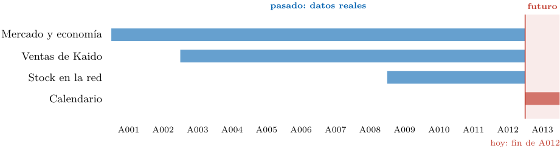
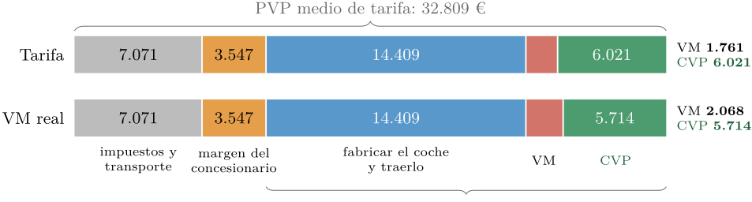
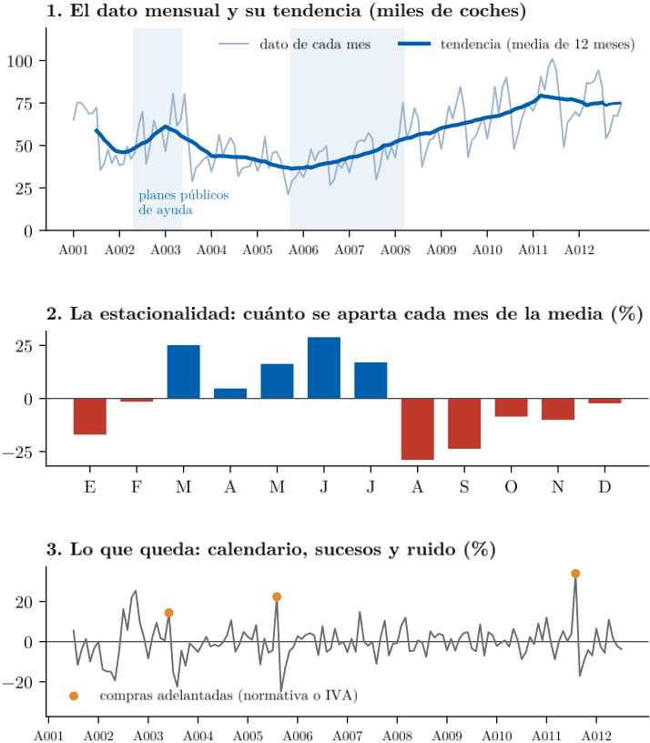
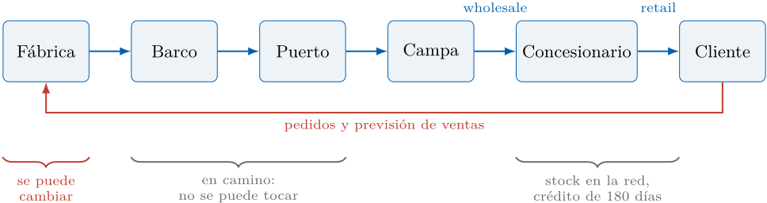
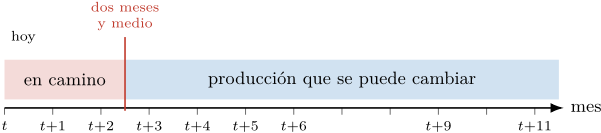
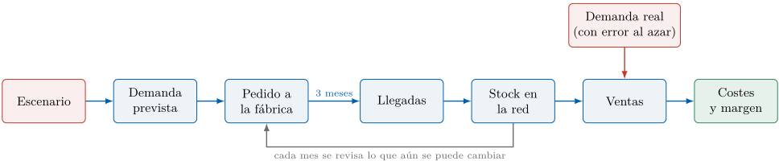

Simulación de Sistemas Logísticos · Caso de uso

# Kaido Motors España: demanda, stock y beneficio

> Versión de lectura del [PDF original](kaido-motors-case-study.pdf). Se han
> recuperado sus fórmulas, reparado tablas y código, y extraído las imágenes a
> `docs/img/`. Los nombres de los CSV y la ruta `data/` se han adaptado a este
> repositorio; las [equivalencias](../data/README.md) permiten consultar el original.
> Las notas de adaptación se identifican expresamente. Esta versión contiene el
> enunciado, no los resultados del trabajo.

Jacinto Velasco y Javier Goikoetxea

Universidad Alfonso X el Sabio, Madrid, España

Resumen. Kaido Motors España importa coches fabricados fuera de Europa y los vende a través de 64 concesionarios. En A012 el mercado cayó y Kaido vendió más que nunca, pero la red se llenó de coches viejos y el beneficio real se quedó muy por debajo del previsto. La directora de Planificación tiene tres semanas para proponer cuántos coches fabricar en A013, sabiendo que lo que se venderá en los próximos dos meses y medio ya viene en camino. El caso pide construir un modelo de demanda mensual para cada uno de los siete segmentos y simular tres escenarios (central, optimista y pesimista) con sucesos económicos, geopolíticos, de producto y de la cadena de suministro. Con esa simulación hay que decidir cuánto fabricar y qué segmentos empujar, y estimar cuánto cuesta equivocarse por arriba o por abajo.

Palabras clave: Previsión de la demanda · Series temporales · Simulación de escenarios · Incertidumbre · Gestión del stock · Distribución de automóviles

Caso de uso basado en un caso real. Los datos y las personas se han modificado, y los datos se han camuflado para su uso académico. Los nombres de la empresa y de las personas son inventados.

Asignatura: Simulación de Sistemas Logísticos. Profesor: Javier Goikoetxea.

Caso de uso elaborado por Jacinto Velasco y Javier Goikoetxea.

## 1. Tres semanas para decidir

Acaba de cerrarse el año A012 y Laura Méndez, directora de Planificación de Kaido Motors España (en adelante, Kaido), tiene tres semanas para llevar al comité de dirección el plan de ventas y de producción de A013. Lleva días dándole vueltas a un año que no termina de entender.

En los siete segmentos en los que compite Kaido se vendieron en A012 un 3,4 % menos coches que el año anterior: 902.000 frente a 934.000. Kaido, en cambio, vendió un 8,5 % más: 23.175 coches frente a 21.362. Parece una buena noticia, pero tiene truco. Hasta octubre Kaido vendía prácticamente lo mismo que el año anterior. Todo el crecimiento llegó en noviembre y diciembre, cuando muchos clientes adelantaron la compra para evitar

el cambio de normativa de A013. Esas ventas no se van a repetir: son coches que se habrían vendido en A013. Mientras tanto, la red de concesionarios se fue llenando. La producción se había planificado pensando en un mercado que seguía creciendo y los barcos siguieron llegando al puerto de Barcelona: en enero había unos 2.900 coches en la red y en octubre, 4.186. Las compras de fin de año la vaciaron hasta 2.877, pero los que quedaron eran viejos. En enero el 20 % de los coches de la red llevaba más de 90 días facturado sin venderse; en diciembre, el 35 %. Para venderlos hubo que poner dinero encima de la mesa en forma de descuentos, campañas e incentivos a los concesionarios. Ese dinero es la otra cifra que no le cuadra. Con los precios y el presupuesto comercial de la tarifa de A013, un coche como los que se vendieron en A011 y A012 debería dejarle a la marca unos 3.900 € después de pagar su venta. Con lo que de verdad se gastó en venderlos, le deja unos 3.450 €: unos 460 € menos por coche, más de 20 millones de euros en los dos años.

Laura no puede reaccionar tan rápido como le gustaría. Los coches se fabrican lejos y viajan en barco, así que lo que se va a vender en los próximos dos meses y medio ya está en camino y no se puede tocar. Solo puede cambiar lo que se fabrique a partir de ahí. Si se equivoca por arriba, el exceso llega igual y envejece en los concesionarios; si se equivoca por abajo, pierde ventas o tiene que traer coches de otros países a un precio peor. Todo depende de lo bien que entienda y prevea la demanda.

Tabla 1: Las palabras del caso.

| Término | Significado |
|---|---|
| PVP                      | Precio que paga el cliente, con impuestos.                                                                       |
| PFF                      | Precio franco fábrica: el precio del coche sin impuestos ni transporte. Todos los márgenes se calculan sobre él. |
| Margen del concesionario | Descuento sobre el PFF que la marca da al concesionario. Es bruto: con él paga sus gastos.                       |
| Wholesale                | Venta de la marca al concesionario, cuando le factura el coche.                                                  |
| Retail                   | Venta del concesionario al cliente, cuando se matricula el coche. Es la que mide la demanda.                     |
| Stock en la red          | Coches facturados a los concesionarios que todavía no se han vendido.                                            |
| En camino                | Coches que ya han salido de la fábrica y viajan hasta Barcelona. No se pueden cambiar.                           |
| VM                       | Lo que la marca gasta en vender cada coche: descuentos, campañas e incentivos.                                   |
| CVP                      | Lo que le queda a la marca por coche después del VM. CVP más VM es su beneficio bruto.                           |
| Automatriculación        | Coche que el concesionario o la marca matriculan a su nombre. Cuenta como venta, pero no es demanda.             |
| Transfer                 | Coche traído del stock de otro país europeo cuando faltan coches.                                                |

Pasado y futuro. Los años del caso se llaman A001, A002 y así hasta A013. De A001 a A012 los datos son reales: es el pasado, lo que ya ocurrió. A012 es el último año cerrado, y el caso ocurre justo al terminar diciembre de A012. A013 es el futuro, el año que hay que planificar: de él no hay ventas, ni mercado, ni economía; solo se conoce el calendario (`calendario_mensual_a013.csv`). No todos los datos empiezan a la vez (figura 1): el mercado y la economía empiezan en A001, las ventas de Kaido en A003 y el stock de la red en A009. Para comprobar un modelo se hace como si A012 fuera el futuro: se entrena con los datos hasta A011 y se compara lo que prevé con lo que pasó en A012. El anexo 4 explica cómo convertir estos años en fechas para Python.

Figura 1: Qué años cubre cada fichero. De A001 a A012 los datos son reales; A013 es el año que hay que prever.



## 2. Cómo funciona el negocio

La tabla 1 recoge las palabras que se usan en el sector y en el resto del caso.

### 2.1. Una filial que compra, guarda y revende

La marca fabrica sus coches fuera de España. En cada país europeo tiene una filial importadora que se encarga de venderlos; en España esa filial es Kaido Motors España. Kaido no fabrica nada y tampoco vende directamente al público. Recibe los coches en el puerto de Barcelona, los guarda en una campa central y los reparte entre 64 concesionarios independientes, que son quienes tratan con el cliente. En este caso hablaremos de la marca para referirnos al grupo completo, la matriz que fabrica y la filial que importa, porque el beneficio que interesa es el de los dos juntos.

En este negocio hay dos ventas. La primera ocurre cuando la marca factura el coche a un concesionario (wholesale). La segunda, cuando el concesionario se lo vende a un cliente y lo matricula a su nombre (retail). En Kaido cada coche que llega se asigna a un concesionario, de modo que a la larga se facturan tantos coches como se venden. Lo que cambia es el tiempo que pasa entre una venta y la otra, y ese tiempo cuesta dinero.

### 2.2. Cómo se reparte el precio

Al PFF se le suman 300 € de transporte, que la marca cobra y paga al transportista sin ganar nada con ello, y sobre ese importe se aplican el IVA (21 %) y el impuesto de matriculación, que depende de las emisiones y va del 0 % al 14,75 %. El resultado es el PVP de tarifa, lo que pagaría el cliente sin descuentos.

El concesionario no compra el coche al PFF. La marca le hace un descuento pactado por contrato, que es su margen y tiene dos partes: una base, entre el 9 % y el 12 % del PFF según el segmento, que se descuenta directamente en la factura, y una parte variable, de alrededor del 2 %, que la marca le paga a final de año si cumple sus objetivos. Ese margen no es lo que gana el concesionario: con él tiene que pagar a sus vendedores, sus instalaciones, la preparación de los coches y los intereses del stock. En el sector, lo que le queda limpio a un concesionario suele estar entre el 1 % y el 2 % de lo que factura.

Por eso el concesionario paga por el coche el PFF menos su margen base, y la marca, que a final de año le abona el variable, se queda con el PFF menos el margen completo. Si a ese ingreso se le resta lo que cuesta el coche (fabricarlo, traerlo en barco, pagar la aduana y moverlo por España), queda el beneficio bruto de la marca. La marca lo calcula para cada versión en su tarifa y lo divide en dos partes: el VM, el dinero que presupuesta para vender el coche, y el CVP, lo que le queda después de gastarlo.

La figura 2 muestra el reparto para un SUV medio, el segmento que más vende Kaido. De un PVP medio de 32.809 €, 7.071 € son impuestos y transporte y 3.547 € margen del concesionario. Quedan 22.191 € de ingreso para la marca, de los que 14.409 € son el coste de fabricar el coche y traerlo. Los 7.782 € restantes son su beneficio bruto.



Figura 2: Reparto del PVP medio de un SUV medio vendido en A011 y A012, en euros por coche (€/coche), sin la prima de CO2. Arriba, con el VM que prevé la tarifa; abajo, con el que de verdad se gastó. Las cifras pueden no sumar exactamente por redondeo.

### 2.3. El gasto comercial

Sobre el papel, de esos 7.782 € la marca pensaba gastar 1.761 € en vender el coche y quedarse con 6.021 €. En la práctica gastó 2.068 € y se quedó con 5.714 €. Ese gasto, el VM, es el dinero que la marca pone coche a coche para que se venda: descuentos de campaña que el cliente ve en la factura, incentivos a los concesionarios por cumplir objetivos puntuales, apoyo a las ventas a empresas y a los coches de demostración, y campañas de financiación. Queda registrado en cada venta, así que se puede comparar con lo presupuestado. El anexo 3 muestra en qué se gasta.

El VM crece cuando cuesta vender. Desde A009, que es cuando se puede saber cuánto tiempo estuvo cada coche en la red, la marca gastó de media 2.083 € en los coches que se vendieron antes de 90 días y 2.600 € en los que pasaron de 180. Un coche que envejece no solo cuesta dinero mientras espera: también cuesta más venderlo.

### 2.4. El coste de un coche parado

Cuando la marca factura un coche al concesionario, este no lo paga en ese momento. Una financiera con la que trabaja la marca le presta el dinero durante 180 días para que primero lo venda y luego lo pague. El arreglo tiene un coste para los dos.

Para la marca, cada día que un coche facturado pasa sin venderse le cuesta 2 € entre la parte de la financiación que asume, el seguro y la gestión, hasta un máximo de 180 días. Un coche que se vende a los 60 días le ha costado 120 €; uno que tarda 200 días, 360 €.

El concesionario paga a la financiera un interés anual por los días que el coche está parado, como quien paga un alquiler. Los primeros 90 días el tipo es muy bajo, un 1 % anual sobre el PFF; del día 91 al 180 sube al 5 % anual. En un SUV medio eso son 0,71 € al día al principio y 3,53 € al día después; si lo vende justo el día 180, habrá pagado unos 380 €. El día 181 el crédito vence y el concesionario tiene que pagar el coche al contado sin saber cuándo lo va a vender: unos 22.650 €, que son el PFF menos su margen base. A partir de ese momento el coche es suyo y todo el coste corre de su cuenta; el caso ya no cuenta más intereses.

### 2.5. Cuando faltan coches

Si la demanda sorprende al alza y lo que viene en camino no llega, la marca tiene una salida: traer coches del stock de otros países europeos. Es lo que en la empresa llaman un transfer. Llegan antes que un coche nuevo de fábrica, pero el viaje y los ajustes de precio entre filiales tienen un coste: el 20 % del beneficio bruto del coche. En un SUV medio, que deja 7.782 € de beneficio bruto, el transferido deja unos 6.226 €; en un coche pequeño, que deja 1.842 €, unos 1.474 €.

### 2.6. Un coste que puede llegar en A013

A partir de A013 entra en vigor una normativa europea que penaliza a cada marca por las emisiones medias de los coches que vende. La matriz todavía no ha decidido si repartirá esa penalización entre sus filiales. Si lo hace, cada coche de combustión cargará con una prima de CO2 de varios miles de euros: de media, entre 1.900 y 4.500 € por coche según el segmento (columna `prima_co2_eur` de `catalogo_segmentos.csv`), y varios segmentos pasarían a dejar muy poco o a perder dinero. Los márgenes del caso no incluyen esa prima. Que la matriz la cargue es uno de los sucesos del escenario pesimista.

## 3. Siete segmentos, siete coches

Kaido compite en siete segmentos del mercado: coches pequeños, compactos, berlinas medias, SUV pequeños, SUV compactos, SUV medios y descapotables. El caso se limita a ellos. Los monovolúmenes y los SUV grandes que Kaido vendió en los primeros años ya no están en la gama y quedan fuera.

Cada coche de Kaido tiene un código formado por las dos primeras letras de su código de producto, o por sus tres primeros caracteres (como DL8 o DGK) cuando dos coches distintos comparten las dos primeras letras. A lo largo de los años un mismo coche cambia de código con cada renovación: nueva generación, cambio de motor o actualización del año. Si se ordenan los códigos por su primera letra y por la fecha de su última venta, se ve que en cada segmento todos los códigos de Kaido empiezan por la misma letra y se van relevando unos a otros. La D la comparten tres segmentos de la misma familia (el coche pequeño, el SUV pequeño y el SUV compacto), así que dentro de ella manda el segmento. El SUV medio, por ejemplo, ha tenido nueve códigos, todos empezados por K. Por eso el caso trata cada segmento como un solo coche: la demanda de Kaido en el SUV medio es la suma de todos sus códigos K.

El fichero `catalogo_modelos.csv` recoge esa agrupación, con la fecha de la primera y la última venta de cada código. En las ventas mensuales se marca el mes en que empieza a venderse un código nuevo con volumen, porque una renovación de gama suele mover la demanda. La gama de A013 incluye 21 códigos, siete de ellos nuevos y sin historia, repartidos entre los segmentos de coches pequeños, SUV pequeños, SUV compactos y SUV medios. El anexo 1 resume cada segmento.

## 4. El mercado

El mercado español de turismos vive de la economía. En los siete segmentos de Kaido pasó de 704.000 coches en A001 a 450.000 en A005, se recuperó poco a poco hasta los 934.000 de A011 y en A012 volvió a bajar. Es un mercado de reposición: la mayoría de compradores cambia un coche viejo por otro nuevo, y cuando las cosas van mal esa compra se aplaza.

No todos los compradores responden a lo mismo. Los particulares, que se han llevado el 79 % de los coches de Kaido desde A003 (el 75 % en A011 y A012), miran su renta, su confianza y lo que les cuesta financiarse. Las empresas y el renting, el 19 % (el 23 % en los dos últimos años), dependen de la marcha de la actividad económica. Los alquiladores, el 2 % restante, compran de marzo a junio para la temporada turística. Por eso los datos vienen separados por canal.

Parte de las ventas son automatriculaciones, que se concentran a final de mes y de trimestre, cuando marcas y concesionarios aprietan para cumplir objetivos. En Kaido suponen cerca del 11 % de las matriculaciones desde A003. Y todos los compradores reaccionan a los cambios de impuestos o de normativa adelantando la compra:

el mes anterior a una subida las ventas se disparan, y los siguientes caen. Ya pasó en A011 y ha vuelto a pasar en noviembre y diciembre de A012, ante el cambio de normativa de A013. La caída que suele venir después está todavía por llegar.

En cada segmento, la industria agrupa a los rivales directos de Kaido, y la cuota de Kaido se mide frente a ellos. Va desde menos del 1 % en los coches pequeños hasta el 67 % en el nicho de los descapotables, donde apenas tiene competencia (anexo 2).

## 5. La demanda como serie temporal

Una serie temporal es una lista de datos ordenados en el tiempo, uno por mes en este caso: los coches que se matricularon en enero de A001, en febrero, en marzo, y así hasta diciembre de A012. Hay una serie para el mercado de cada segmento y canal, y otra para las ventas de Kaido. Prever la demanda es alargar esa lista doce meses más, hasta diciembre de A013.

El dato de cada mes es la suma de varias fuerzas que conviene separar, porque cada una se prevé de una manera distinta. La figura 3 las muestra para el mercado de los siete segmentos:

1. La tendencia. Es el nivel de fondo, lo que se vende en un mes normal. Se ve bien con la media de los últimos doce meses, que borra los altibajos de cada mes. Sube y baja con la economía: cayó a casi la mitad entre A001 y A005 y se recuperó después.
2. La estacionalidad. Cada mes del año se parece al mismo mes de otros años. Las ventas son altas de marzo a julio, con picos en marzo y junio, se hunden en agosto y septiembre y vuelven a subir a final de año. Marzo vende un 25 % más que un mes medio y agosto un 29 % menos, sea cual sea el tamaño del mercado.
3. El calendario. Un mes con más días laborables vende más, y la Semana Santa, que unos años cae en marzo y otros en abril, quita días de venta y cambia de mes las compras de los alquiladores.
4. Los sucesos. Planes públicos de ayuda a la compra, subidas del IVA y cambios de normativa que adelantan compras. Son pocos, se conocen y hay que marcarlos, porque si no el modelo los confunde con demanda.
5. El ruido. Lo que queda y no se puede explicar. Una buena previsión deja solo esto.

Como la estacionalidad y la economía actúan en proporción (un buen mes vende un tanto por ciento más, sea el mercado grande o pequeño), las piezas se multiplican:

ventas = tendencia × estacionalidad × calendario × sucesos × ruido.

Si se toma el logaritmo de las ventas, las piezas pasan a sumarse, que es lo que necesitan la mayoría de los modelos. Por eso se suele trabajar con el logaritmo y se deshace al final.

### 5.1. Las variables que se pueden usar

La tendencia se explica con la economía. El fichero `economia_eventos_mensuales.csv` trae solo las variables que se pueden usar bien: están completas desde A001, tienen sentido para la venta de coches y su relación con el mercado es estable. Se han dejado fuera otras series del fichero original, como el Euríbor, varios índices de precios o el tipo de cambio, porque les faltaban datos o se movían por razones ajenas al automóvil. La tabla 2 resume las que quedan.

Figura 3: El mercado de los siete segmentos separado en sus piezas. La franja azul marca los años con planes públicos de ayuda; los puntos naranjas, los meses con compras adelantadas. La tendencia de los últimos meses (a trazos) es provisional, porque le faltan los meses que vienen después.



Tabla 2: Variables del fichero `economia_eventos_mensuales.csv`.

| Variable             | Qué mide                                                                               | Canal                           |
|----------------------|----------------------------------------------------------------------------------------|---------------------------------|
| Economía             |                                                                                        |                                 |
| paro                 | Tasa de paro (%, trimestral)                                                           | Todos |
| consumo_privado_var  | Crecimiento anual del consumo de los hogares (%, trimestral)                           | Particulares |
| confianza_consumidor | Confianza de los consumidores (índice). Se adelanta unos meses                         | Particulares |
| hipotecas            | Hipotecas firmadas en el mes (número): si los bancos prestan y las familias se atreven | Particulares                    |
| tipo_credito_consumo | Interés de los préstamos al consumo (%)                                                | Particulares                    |
| pib_var              | Crecimiento anual del PIB (%, trimestral)                                              | Empresas                        |
| indice_actividad     | Actividad de las empresas (índice)                                                     | Empresas                        |
| indice_comercio      | Actividad del comercio (índice)                                                        | Part. y emp.                    |
| viajeros_var         | Variación anual de los viajeros alojados (%)                                           | Alquiladores                    |
| Sucesos              |                                                                                        |                                 |
| incentivo_publico    | 1 si hay un plan público de ayuda a la compra (0 o 1)                                  | Particulares                    |
| adelanto_compras     | 1 en los meses con compras adelantadas por un cambio de normativa (0 o 1)              | Todos                           |
| caida_tras_adelanto  | 1 en los meses de caída que siguen a un adelanto (0 o 1)                               | Todos                           |
| subida_iva           | 1 el mes anterior a una subida del IVA (0 o 1)                                         | Todos                           |
| Calendario           |                                                                                        |                                 |
| dias_laborables      | Días laborables del mes (días)                                                         | Todos                           |
| semana_santa         | 1 si la Semana Santa cae en ese mes (0 o 1)                                            | Todos                           |

Tres consejos para usarlas. Primero, compare crecimientos con crecimientos: la variación de las ventas frente al mismo mes del año anterior con la variación de cada variable. Así se quita la estacionalidad de las dos y se ve mejor si se mueven juntas. Segundo, las variables trimestrales, como el paro o el PIB, repiten el mismo valor en los tres meses del trimestre; es normal y no hay que corregirlo. Tercero, y más importante: para prever A013 hace falta saber cuánto valdrá cada variable en A013, y eso no se sabe. Hay dos salidas. Una es usar el dato de hace unos meses, que ya se conoce cuando se decide la producción: como la producción se fija con dos meses y medio de antelación, un retraso de tres meses encaja bien. La otra es plantear escenarios (por ejemplo, que el paro suba un punto o baje medio) y ver cómo cambia la previsión. El calendario sí se conoce de antemano y está en `calendario_mensual_a013.csv`.

### 5.2. Cómo abordar la previsión

Un camino sencillo, que se puede ir complicando, tiene cuatro pasos:

1. Limpiar la serie de Kaido: quitar las automatriculaciones y marcar los meses con compras adelantadas o con falta de coches. Lo que queda es la demanda que hay que prever.
2. Prever el mercado de cada segmento con su estacionalidad, el calendario y dos o tres variables económicas de la tabla 2, no todas: con doce años de datos, un modelo con muchas variables se aprende de memoria el pasado y falla en el futuro.
3. Prever la cuota de Kaido en cada segmento, teniendo en cuenta las renovaciones de gama, y multiplicar: demanda de Kaido = mercado del segmento × cuota.
4. Comprobar el modelo antes de fiarse de él: entrenarlo con los datos hasta A011, prever A012 y comparar con lo que pasó. Si convence, se vuelve a estimar con todos los datos y se prevé A013.

El anexo 4 explica cómo convertir los años del caso en fechas para Python y trae un ejemplo con estos pasos. La aplicación del caso permite ver cada serie, sus piezas y la relación con cada variable antes de ponerse a modelizar.

## 6. De la fábrica al cliente

La figura 4 resume el camino de un coche. La fábrica produce según el plan que le pasa la filial. El coche viaja en barco hasta Barcelona, espera en la campa hasta que se asigna a un concesionario y allí espera a su comprador. La información viaja en sentido contrario: el cliente hace su pedido al concesionario, el concesionario a la marca y la marca a la fábrica.

Figura 4: El camino físico del coche (azul) y el de la información (rojo).



La restricción clave es el tiempo. Desde que el barco zarpa hasta que llega a Barcelona el coche está en camino (en la empresa lo llaman in transit) y no hay forma de cambiarlo. Lo que se va a facturar a la red en los próximos dos meses y medio ya está en esa situación. La producción solo se puede modificar para los meses siguientes (figura 5). Cada mes, al cerrar las ventas, Laura puede revisar su previsión y ajustar la producción que todavía está a tiempo de cambiar. Al empezar A013, lo que ya viene en camino es lo que se decidió durante A012, y habrá que estimarlo.

Figura 5: Qué se puede cambiar en cada revisión mensual.



Para no quedarse sin coches por un error de previsión, la marca mantiene un stock mínimo de seguridad, y sabe cuánto stock necesita en cada momento: ese mínimo más lo que espera vender mientras llega lo que ya está en camino. Por debajo del mínimo se pierden ventas o hay que recurrir al transfer; por encima de lo necesario, los coches envejecen.

## 7. Los cálculos: de la demanda al stock y a la producción

Con una previsión de demanda en la mano, el stock y la producción salen de unas cuentas sencillas que se hacen mes a mes y segmento a segmento. En ellas, $t$ es el mes en que se decide; $D$, la demanda, los coches que los clientes quieren comprar; $V$, las ventas, los que de verdad se venden; $\hat{D}$, la demanda prevista; $L$, los coches que llegan y se facturan a la red; y $S$, el stock de la red a fin de mes.

### 7.1. El stock de cada mes

El stock de un mes es el del mes anterior, más lo que llega, menos lo que se vende. No se puede vender más de lo que hay: si la demanda supera los coches disponibles, se venden todos y el resto son ventas perdidas o transfers. Por eso el stock nunca es negativo:

$$
V_t = \min\left(D_t, S_{t-1} + L_t\right),
\qquad S_t = S_{t-1} + L_t - V_t.
$$

Es la misma cuenta que cumplen los datos de `stock_red_mensual.csv` con su columna `wholesale`. De ella salen dos medidas que el comité mira siempre. La primera es la cobertura, los meses de venta que hay en la red: el stock dividido entre la demanda media de un mes. El SUV medio cerró A012 con 536 coches y vende unos 684 al mes, así que tenía 0,8 meses de stock. La segunda es la antigüedad: si se supone que primero se vende el coche más viejo, se puede seguir mes a mes cuántos pasan de 90 y de 180 días.

### 7.2. Lo que ya no se puede cambiar

Un coche tarda unos dos meses y medio desde que sale de la fábrica hasta que se factura a la red. Redondeando, lo que llega en los dos meses siguientes ya está en camino, y lo primero que se puede cambiar es lo que llega dentro de tres meses. Por eso, cada mes t se decide la llegada del mes t +3.

### 7.3. El stock de seguridad

La previsión se equivoca, y el stock de seguridad es el colchón que cubre ese error mientras llegan los coches:

$$
SS = z \times \sigma \times \sqrt{3}.
$$

Aquí σ es el error típico de la previsión de un mes, en coches; el 3 son los meses que tarda en llegar lo que se decide hoy; y z fija cuánto riesgo se acepta: 1,28 para cubrir nueve de cada diez meses y 1,65 para cubrir diecinueve de cada veinte. Cuanto más caro sea quedarse corto frente a pasarse, más alto debe ser z. La fórmula supone que los errores de un mes y del siguiente no tienen nada que ver; si se parecen, el colchón tiene que ser mayor, y la simulación lo mide mejor que la fórmula.

### 7.4. Cuánto pedir a la fábrica

Primero se proyecta el stock hasta el último mes que ya no se puede tocar:

$$
\hat{S}_{t+2} = S_t + L_{t+1} + L_{t+2} - \hat{D}_{t+1} - \hat{D}_{t+2}.
$$

Después se pide lo que falta para cubrir la demanda prevista del mes t +3 y dejar el stock de seguridad:

$$
L_{t+3} = \max\left(0, \hat{D}_{t+3} + SS - \hat{S}_{t+2}\right).
$$

Esa llegada es la producción que hay que pedir a la fábrica para ese mes. Al mes siguiente se repite la cuenta con las ventas reales y la previsión revisada: es un plan que rueda.

La tabla 3 lo aplica al SUV medio al empezar A013. El stock de diciembre es el real; lo que viene en camino y la previsión son cifras supuestas, solo para enseñar la cuenta.

Tabla 3: Ejemplo de cálculo para el SUV medio, decidido a final de diciembre de A012, en coches.

| Paso                                                                            |   Coches (unidades) |
|---------------------------------------------------------------------------------|---------------------|
| Stock en la red a fin de diciembre, $S_t$ | 536 |
| Llegadas ya en camino para enero y febrero, $L_{t+1} + L_{t+2}$ (supuesto: 700 cada mes) | 1.400 |
| Demanda prevista de enero y febrero, $\hat{D}_{t+1} + \hat{D}_{t+2}$ (supuesto: 550 y 600) | 1.150 |
| Stock proyectado a fin de febrero, $\hat{S}_{t+2}$ | 786 |
| Stock de seguridad con $\sigma = 100$ y $z = 1{,}28$, $SS$ | 222 |
| Demanda prevista de marzo, $\hat{D}_{t+3}$ (supuesto) | 850 |
| Llegada que hay que pedir para marzo, $L_{t+3} = 850 + 222 - 786$ | 286 |

El ejemplo enseña algo que pasa a menudo: si lo que viene en camino es mucho, el ajuste lo sufre el primer mes que todavía se puede tocar, y la producción de ese mes cae de golpe.

### 7.5. El coste de equivocarse

Pasarse cuesta poco cada día, pero se acumula. Cada coche que sobra le cuesta a la marca 2 € al día, unos 60 € al mes, hasta los 180 días; al concesionario, los intereses de su crédito; y si el coche pasa de 90 días, venderlo exige más VM: en el SUV medio, 2.090 € en lugar de 1.895 €.

Quedarse corto cuesta de golpe. Una venta perdida es el CVP que no se gana (5.714 € en el SUV medio, con el VM real), y un coche traído por transfer cuesta el 20 % del beneficio bruto (1.556 € en el SUV medio).

Siguiendo con el ejemplo, si en marzo se venden 700 coches en lugar de 850, sobran 150 durante un mes, que le cuestan a la marca unos 9.000 €. Si se venden 1.000, faltan 150: perder esas ventas cuesta unos 857.000 €, y traerlos por transfer, unos 233.000 €. Estas cuentas cambian mucho de un segmento a otro, y por eso el stock de seguridad no tiene por qué ser igual en todos.

### 7.6. Cómo encaja con la simulación

En la simulación estas cuentas se hacen para cada año simulado. Se parte del plan de producción pensado para el escenario central y se simula el año con la demanda de cada escenario, también la del optimista y la del pesimista. Cada mes se miran las ventas reales, se revisa la previsión y solo se corrige la llegada de dentro de tres meses, como en la tabla 3; lo que ya viene en camino no se toca. Mes a mes se anotan el stock, su edad, las ventas perdidas, los transfers y los costes. Así se ve cuánto cuesta el plan cuando el año no sale como se esperaba.

## 8. La reunión del comité

Laura conoce de sobra las posiciones que se va a encontrar. El director de Ventas quiere stock abundante para no perder ni una operación, sobre todo en primavera, cuando compran los alquiladores, y está convencido de que los pedidos de los concesionarios se mueven mucho más que las ventas a los clientes. El director financiero quiere menos coches parados y menos gasto comercial, y no entiende por qué se siguen empujando segmentos que apenas dejan dinero. Los concesionarios se quejan de que les llegan coches que no han pedido y de que los intereses y el pago al contado a los 180 días se comen su margen. Y la matriz, que reparte la capacidad de sus fábricas entre todos los países, no quiere oír hablar de cambios en lo que ya está en producción.

Laura tiene claro que las ventas del pasado no son una buena medida de la demanda: hubo meses en que faltaron coches, meses inflados por automatriculaciones y meses en que se adelantaron compras. Sabe también que lo que se fabrica hoy se vende dentro de varios meses, y que si el mercado cae entretanto los coches llegan igual. Y ahora sabe que cada error de previsión se paga, en ventas perdidas o en coches que envejecen y hay que malvender.

## 9. Lo que tiene que decidir el comité

El comité tiene que decidir cuántos coches fabricar en A013, cuánto stock tener en la red y dónde gastar el dinero comercial. Todo depende de la demanda, y la demanda no se conoce. Por eso Laura necesita dos herramientas: un modelo de demanda, que diga cuánto se venderá cada mes en cada segmento, y una simulación de escenarios, que diga cuánto puede cambiar esa cifra si el año sale mejor o peor de lo esperado.

### 9.1. Las cinco preguntas

1. ¿Cuál es la demanda real de Kaido? Separe lo que compraron los clientes de las automatriculaciones, las compras adelantadas y los meses en que faltaron coches. ¿Cuánto creció de verdad la demanda en A012?
2. ¿Cuánto vamos a vender en A013? Construya un modelo de demanda mensual para cada segmento, con la economía, el calendario y el producto, y compruébelo con los datos de A012.
3. ¿Qué pasa si el año sale mejor o peor? Simule un escenario central, uno optimista y uno pesimista, con su incertidumbre. ¿Entre qué cifras se moverán las ventas de cada segmento?
4. ¿Cuántos coches fabricamos y cuánto stock queremos? Convierta la demanda simulada en un plan de producción mensual por segmento, teniendo en cuenta lo que ya viene en camino (sección 7).
5. ¿Cuánto cuesta equivocarse y qué recomendamos? Compare lo que cuesta quedarse corto con lo que cuesta pasarse. Diga qué segmentos conviene empujar o frenar, qué señales hay que vigilar cada mes y cuándo cambiar la producción.

### 9.2. Los tres escenarios

Un escenario es una historia sobre cómo puede ser A013 que se traduce en valores de las variables del modelo. La tabla 4 propone tres: uno central, con lo que parece más probable, y dos extremos razonables, uno pesimista y otro optimista. Cada equipo puede ajustarlos, pero tiene que decir qué supone y darle tamaño con episodios parecidos de los datos, como la crisis de A004 y A005, los planes de ayuda o el adelanto de compras de A011.

Tabla 4: Los tres escenarios de A013.

|             | Pesimista                                                                                       | Central                             | Optimista                                           |
|-------------|-------------------------------------------------------------------------------------------------|-------------------------------------|-----------------------------------------------------|
| Economía    | El paro sube dos puntos y la confianza sigue baja.                                              | Como al final de A012.              | El paro baja un punto y el crédito se abarata.      |
| Geopolítica | Un conflicto encarece el combustible y sube el arancel a los coches fabricados fuera de Europa. | Sin cambios.                        | Baja el combustible y el euro se fortalece.         |
| Normativa   | La caída tras las compras adelantadas dura medio año y la matriz carga la prima de CO2.         | Dura tres meses.                    | Dura un mes y llega un plan de ayuda a la compra.   |
| Producto    | Un lanzamiento se retrasa tres meses.                                                           | Los códigos nuevos llegan a tiempo. | Los códigos nuevos se venden mejor de lo previsto.  |
| Turismo     | Llegan menos turistas y los alquiladores compran menos.                                         | Como en A012.                       | Llegan más turistas y los alquiladores compran más. |
| Suministro  | Falta una pieza y la fábrica pierde un mes de producción de un segmento.                        | Sin problemas.                      | La fábrica tiene coches de sobra.                   |

Cada suceso entra en el modelo por un sitio distinto: la economía, el turismo y el combustible, por las variables de `economia_eventos_mensuales.csv`; el producto, por la cuota de Kaido; el arancel y la prima de CO2, por el beneficio de cada coche; y el suministro, por los coches que llegan.

### 9.3. El trabajo: simular un año de la cadena de suministro

Para cada escenario el trabajo tiene tres pasos, que resume la figura 6. Primero, estime la demanda: con su modelo, cuántos coches se venderán cada mes de A013 en cada segmento. Segundo, simule el año mes a mes con las cuentas de la sección 7: lo que se pide a la fábrica, lo que llega tres meses después, lo que se vende y el stock que queda en la red. Como la demanda real nunca es la prevista, repita el año muchas veces, por ejemplo mil, con un error al azar en la demanda de cada mes. Tercero, haga las cuentas: con las ventas y el stock de cada mes salen el coste del stock, las ventas perdidas o los transfers, el VM y el margen que deja el año.

Figura 6: Un año de la cadena de suministro, mes a mes. Se repite muchas veces, cada vez con otra demanda real.



### 9.4. Qué hay que entregar

Un resumen ejecutivo de dos páginas para el comité. Tiene que decir cuántos coches propone fabricar cada mes en cada segmento y qué va a pasar con ese plan: cuánto se vende, cuánto stock queda en la red, qué costes tiene y qué margen deja. Y tiene que decir el riesgo: cuánto cambian los costes y el margen si el año sale pesimista u optimista. La tabla 5 es una forma sencilla de resumirlo. Las tres columnas parten del mismo plan, pensado para el escenario central; en las otras dos la demanda real es distinta y el plan solo se puede corregir a tres meses vista. Con el resumen se entregan el código y los datos del modelo y de la simulación, y una presentación de diez minutos.

Tabla 5: Resultados de A013 que debe recoger el resumen ejecutivo, para el total y para cada segmento.

| Indicador | Pesimista | Central | Optimista |
|---------------------------------------------------|-------------------------------|-------------------------------|-------------------------------|
| Coches vendidos (unidades)                        | . . .                         | . . .                         | . . .                         |
| Coches fabricados (unidades)                      | . . .                         | . . .                         | . . .                         |
| Stock medio en la red (coches y meses de venta)   | . . .                         | . . .                         | . . .                         |
| Coches con más de 90 días a fin de año (unidades) | . . .                         | . . .                         | . . .                         |
| Coste del stock para la marca (€)                 | . . .                         | . . .                         | . . .                         |
| Ventas perdidas y transfers (coches y €)          | . . .                         | . . .                         | . . .                         |
| Gasto comercial, VM (€)                           | . . .                         | . . .                         | . . .                         |
| Margen de la marca, CVP (€)                       | . . .                         | . . .                         | . . .                         |

## Anexos

### Anexo 1. Los siete segmentos

Coches de Kaido vendidos en A012, códigos en la gama de A013 y resultado medio por coche en A011 y A012, en euros por coche, con la tarifa de A013 sin la prima de CO2. El beneficio bruto es CVP más VM; el CVP de tarifa usa el VM presupuestado y el CVP real, el que de verdad se gastó. La prima de CO2 se da aparte: es lo que costaría cada coche de más si la matriz la cargara.

| Segmento   | Descripción   | Letra   |   Coches A012 - (coches) | Códigos A013 - (número)   |   Benef. - bruto (€/coche) |   Prima - CO2 (€/coche) |   CVP - tarifa (€/coche) |   CVP - real (€/coche) |
|------------|---------------|---------|--------------------------|---------------------------|----------------------------|-------------------------|--------------------------|------------------------|
| MSUV       | SUV medio     | K       |                    8.213 | 4 (2 nuevos)              |                      7.782 |                   4.203 |                    6.021 |                  5.714 |
| SSUV       | SUV pequeño   | D       |                    6.230 | 2 (1 nuevo)               |                      4.833 |                   2.830 |                    3.328 |                  2.568 |
| C          | Compacto      | B       |                    4.189 | 1                         |                      3.672 |                   1.952 |                    2.063 |                  1.187 |
| B          | Pequeño       | D       |                    1.764 | 5 (2 nuevos)              |                      1.842 |                   2.555 |                     -533 |                    -69 |
| CSUV       | SUV compacto  | D       |                    1.435 | 3 (2 nuevos)              |                      6.174 |                   1.912 |                    3.248 |                  3.798 |
| MD         | Berlina media | G       |                      755 | 4                         |                      7.561 |                   2.082 |                    4.855 |                  3.760 |
| S          | Descapotable  | N       |                      589 | 2                         |                      6.841 |                   4.493 |                    4.669 |                  4.631 |

El SUV compacto se lanzó en agosto de A012, así que sus cifras corresponden a sus primeros cinco meses. El coche pequeño es el único que queda en torno a cero: la tarifa le reserva más VM del que deja su beneficio bruto.

### Anexo 2. Cuota de Kaido en sus segmentos, A011 y A012

| Segmento | Descripción | Mercado (coches) | Kaido (coches) | Cuota (%) |
|------------------------|------------------------------|---------------------------------------------|---------------------------------------------|---------------------------------------------|
| MSUV                   | SUV medio                    |                                     305.160 |                                      17.028 | 5,6 %                                       |
| SSUV                   | SUV pequeño                  |                                     283.060 |                                      11.756 | 4,2 %                                       |
| MD                     | Berlina media                |                                      49.296 |                                       1.922 | 3,9 %                                       |
| C                      | Compacto                     |                                     364.988 |                                       7.720 | 2,1 %                                       |
| B                      | Pequeño                      |                                     491.368 |                                       3.557 | 0,7 %                                       |
| CSUV                   | SUV compacto (desde A012-08) |                                     341.119 |                                       1.435 | 0,4 %                                       |
| S                      | Descapotable                 |                                       1.670 |                                       1.119 | 67 %                                        |

El mercado de cada segmento incluye a Kaido y a sus rivales directos según la clasificación de la industria.

### Anexo 3. En qué se gasta el VM, de A003 a A012

| Tipo de gasto          | En qué consiste                                                                                   | Peso (% del VM)   |
|------------------------|---------------------------------------------------------------------------------------------------|-------------------|
| Descuentos de campaña  | Rebajas al cliente final pagadas por la marca                                                     | 52 %              |
| Incentivos a la red    | Pagos extra a los concesionarios por campañas y objetivos puntuales, aparte de su margen variable | 20 %              |
| Ventas especiales      | Apoyo a flotas, empresas, colectivos y empleados                                                  | 16 %              |
| Coches de demostración | Apoyo a los coches que usa el concesionario para pruebas                                          | 6 %               |
| Financiación           | Campañas de financiación al cliente                                                               | 3 %               |
| Otras acciones         | Resto de acciones comerciales                                                                     | 3 %               |

En ese periodo la marca gastó de media 2.081 € por coche vendido.

### Anexo 4. Los años del caso y cómo convertirlos en una serie temporal

Para que no se pueda saber a qué años reales corresponden los datos, los años se han sustituido por un código: el primer año con datos es A001, el siguiente A002, y así hasta A012, el último cerrado. El año que hay que planificar es A013. El código es el mismo en todos los ficheros, de modo que A005 es el mismo año en las ventas, en el mercado y en la economía. Cada mes lleva además tres identificadores: anio (por ejemplo, A011), mes (de 1 a 12) y periodo, que los junta con el día 1 (A0110301 es marzo de A011). También hay un contador, t, que vale 1 en enero de A001 y sube de uno en uno cada mes: A012-12 es el mes 144 y A013 va del 145 al 156.

Las librerías de series temporales de Python necesitan fechas de verdad. La forma más sencilla de conseguirlas es tratar cada código como un año ficticio: A001 como 2001, A002 como 2002, y así sucesivamente. El orden y la distancia entre meses se conservan, que es lo único que necesita un modelo de series temporales. El ejemplo prepara el mercado del SUV medio, lo separa en tendencia, estacionalidad y resto, y ajusta un modelo con dos variables económicas y el calendario.

```python
import numpy as np
import pandas as pd
import statsmodels.api as sm
from statsmodels.tsa.seasonal import STL

leer = lambda f: pd.read_csv(
    "data/" + f, keep_default_na=False, na_values=[""]
)
mercado = leer("mercado_mensual.csv")
macro = leer("economia_eventos_mensuales.csv")


# A001 pasa a ser el año ficticio 2001, A002 el 2002, ...
def fecha(df):
    anio = 2000 + df["anio"].str[1:].astype(int)
    return pd.to_datetime(dict(year=anio, month=df["mes"], day=1))


mercado["fecha"] = fecha(mercado)
macro["fecha"] = fecha(macro)

# Mercado mensual del SUV medio, con frecuencia de inicio de mes.
y = (
    mercado[mercado["segmento"] == "MSUV"]
    .groupby("fecha")["unidades"].sum().asfreq("MS")
)
variables = ["paro", "confianza_consumidor", "dias_laborables", "semana_santa"]
X = macro.set_index("fecha")[variables].asfreq("MS")

# 1. Separar la serie en tendencia, estacionalidad y resto.
partes = STL(np.log(y), period=12).fit()
partes.plot()

# 2. Entrenar hasta A011 (año ficticio 2011) y comprobar con A012.
ent = y.index.year <= 2011
modelo = sm.tsa.SARIMAX(
    np.log(y[ent]), exog=X[ent], order=(1, 0, 0),
    seasonal_order=(0, 1, 1, 12),
).fit(disp=False)
prevision = np.exp(modelo.forecast(12, exog=X[~ent]))
```

> Nota de adaptación: ejecutar desde la raíz del repositorio. El ejemplo conserva
> el método del PDF y usa la economía observada de A012 al prever ese año; para
> una evaluación operativa hay que distinguir qué variables se conocían al decidir.

Dos cuidados. Primero, al leer los ficheros hay que indicar, como en el ejemplo, que solo las celdas vacías son datos que faltan; si no, algunos programas confunden el código de modelo `NA` con un vacío. Segundo, los años ficticios no coinciden con el calendario real, así que los días laborables y la Semana Santa no se deben calcular a partir de la fecha: hay que tomarlos de `economia_eventos_mensuales.csv` y, para A013, de `calendario_mensual_a013.csv`.

### Anexo 5. Los datos

Los datos están en siete ficheros de texto separados por comas dentro de la carpeta `data/`. Las ventas de Kaido coinciden en todos ellos: 125.030 coches entre A003 y A012. Las series mensuales están completas, con ceros en los meses sin ventas.

Unidades:

- Los importes están en euros por coche (€/coche), redondeados al euro, salvo el coste diario del crédito, en euros por coche y día con dos decimales.
- `unidades`, `marca_propia`, `stock_total`, `wholesale` y las columnas que empiezan por `u_` o `s_` están en coches.
- Las que empiezan por `dias_`, en días; `meses_desde_renovacion`, en meses; `cv_medio`, en caballos (CV).
- `codigos`, `codigos_A013` y `n_marcas`, en número.
- Las que empiezan por `pct_` o terminan en `_pct` están en tanto por uno (0,09 es un 9 %).
- `renovacion_gama`, `en_tarifa_A013` y `semana_santa` valen 0 o 1.

#### Ventas: `ventas_kaido_mensuales.csv`

Una fila por mes, segmento y canal, de A003-01 a A012-12.

| Variable | Qué contiene |
|---|---|
| `segmento`, `descripcion` | Segmento (B, C, MD, SSUV, CSUV, MSUV, S) y su nombre |
| `canal` | PARTICULARES, EMPRESAS_RENTING o ALQUILADORES, según el tipo de venta |
| `unidades` | Coches vendidos (matriculados, en coches) |
| `u_automatriculacion` | De ellos, coches de demostración y matriculados por la marca o por el concesionario |
| `u_venta_especial` | De ellos, ventas a empresas y autónomos, colectivos, empleados, renting de concesionario e internet (sin las grandes flotas) |
| `u_0_90`, `u_91_180`, `u_mas_180` | De ellos, según los días que pasaron en la red antes de venderse (desde A009-02) |
| `dias_0_90_medio`, `dias_91_180_medio`, `dias_mas_180_medio` | Días medios en la red de los coches de cada tramo |
| `pvp_medio`, `pff_medio` | PVP y PFF medios de tarifa de los coches vendidos (€/coche) |
| `vm_medio` | VM real medio por coche vendido (€/coche) |
| `renovacion_gama` | 1 el mes en que empieza a venderse un código nuevo con volumen |
| `meses_desde_renovacion` | Meses desde la última renovación de gama del segmento |

#### Stock: `stock_red_mensual.csv`

Una fila por mes y segmento, de A009-01 a A012-12.

| Variable | Qué contiene |
|---|---|
| `stock_total` | Coches en la red de concesionarios a fin de mes (coches) |
| `s_0_90`, `s_91_180`, `s_mas_180` | Los mismos, según los días desde su factura |
| `s_sin_cliente` | De ellos, los que aún no tenían comprador con contrato |
| `wholesale` | Coches facturados a la red ese mes (desde A009-02). El stock de un mes es el del anterior más la facturación menos las ventas, con diferencias de pocos coches |

#### Mercado: `mercado_mensual.csv`

Una fila por mes, segmento y canal, de A001-01 a A012-12.

| Variable | Qué contiene |
|---|---|
| `unidades` | Matriculaciones del segmento: Kaido y sus rivales directos |
| `marca_propia` | De ellas, las de Kaido, iguales a las de `ventas_kaido_mensuales.csv` desde A003 |
| `pct_diesel`, `pct_electrificado` | Peso de los diésel y de los electrificados (híbridos, enchufables y eléctricos) |
| `pct_renting` | Peso del renting (desde A004) |
| `cv_medio`, `n_marcas` | Potencia media y número de marcas que venden en esa celda |

#### Segmentos: `catalogo_segmentos.csv`

Una fila por segmento.

| Variable | Qué contiene |
|---|---|
| `letra`, `codigos` | Letra común de sus códigos y número de códigos con ventas |
| `primer_mes`, `unidades_totales`, `unidades_ult_anio` | Primera venta, coches vendidos en total y en A012 |
| `codigos_A013`, `codigos_nuevos_A013` | Códigos en la gama de A013 y cuántos son nuevos |
| `pvp_medio`, `pff_medio`, `iedmt_pct` | Precios de tarifa e impuesto de matriculación (A011 y A012) |
| `margen_conc_base_pct`, `margen_conc_var_pct`, `margen_bruto_conc_eur` | Margen del concesionario |
| `precio_conc_eur` | Lo que la marca factura al concesionario (PFF menos margen base) |
| `beneficio_bruto_marca_eur`, `prima_co2_eur` | Beneficio bruto de la marca con la tarifa de A013, sin la prima de CO2, y la prima que cargaría cada coche si la matriz la repartiera (€/coche) |
| `vm_tarifa_eur`, `cvp_tarifa_eur` | VM y CVP según la tarifa |
| `vm_real_eur`, `cvp_real_eur` | VM real y CVP real en A011 y A012 |
| `vm_real_0_90_eur`, `vm_real_91_180_eur`, `vm_real_mas_180_eur` | VM real según los días que pasó el coche en la red (desde A009-02) |
| `credito_dia_0_90_eur`, `credito_dia_91_180_eur` | Interés diario que paga el concesionario |

#### Modelos: `catalogo_modelos.csv`

Una fila por código, ordenados por letra y fecha de última venta.

| Variable | Qué contiene |
|---|---|
| `letra`, `segmento`, `codigo_modelo`, `generacion` | Código y segmento (generación distingue un código reutilizado años después) |
| `primer_mes`, `ultimo_mes`, `unidades` | Primera y última venta y coches vendidos (vacío y 0 en los códigos nuevos de A013) |
| `en_tarifa_A013` | 1 si el código forma parte de la gama de A013 |

#### Economía y eventos: `economia_eventos_mensuales.csv`

Una fila por mes, de A001-01 a A012-12. Las quince variables de la tabla 2.

#### Calendario: `calendario_mensual_a013.csv`

Una fila por mes de A013.

| Variable | Qué contiene |
|---|---|
| `dias_laborables`, `semana_santa` | Calendario del año que hay que planificar |

Algunas precisiones sobre cómo se han construido. Los precios de cada coche son los de la tarifa vigente el día en que se vendió; el beneficio bruto, el VM de tarifa y el margen variable salen de la tarifa de A013 y se aplican a cada coche en proporción a su PFF. La antigüedad se cuenta desde que la marca factura el coche a la red, y a los coches que se facturaron y vendieron dentro del mismo mes se les asignan 15 días. Los coches sin ningún gasto comercial registrado cuentan con un VM de cero. En A001 y A002 no hay ventas internas, y las de Kaido en el mercado proceden del registro oficial.
